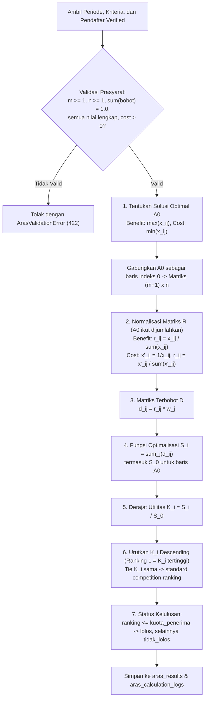

# Alur Algoritma ARAS (Additive Ratio Assessment)

Metode **ARAS** diperkenalkan oleh Zavadskas & Turskis (2010) untuk menentukan peringkat alternatif berdasarkan rasio tingkat utilitas masing-masing alternatif terhadap **solusi optimal ideal ($A_0$)**.

## Diagram Alur Sistem

## Rumus Matematis Setiap Tahap

1. **Pembentukan Matriks Keputusan dengan $A_0$**:
   $$x_{0j} = \begin{cases} \max_i x_{ij}, & \text{jika kriteria } j \text{ bertipe benefit} \\ \min_i x_{ij}, & \text{jika kriteria } j \text{ bertipe cost} \end{cases}$$

2. **Normalisasi Matriks ($R$)**:
   - Kriteria **benefit**:
     $$r_{ij} = \frac{x_{ij}}{\sum_{i=0}^{m} x_{ij}}$$
   - Kriteria **cost**:
     $$x'_{ij} = \frac{1}{x_{ij}}, \qquad r_{ij} = \frac{x'_{ij}}{\sum_{i=0}^{m} x'_{ij}}$$

3. **Matriks Ternormalisasi Terbobot ($D$)**:
   $$d_{ij} = r_{ij} \cdot w_j, \qquad \text{dengan } \sum_{j=1}^{n} w_j = 1$$

4. **Fungsi Optimalisasi ($S_i$)**:
   $$S_i = \sum_{j=1}^{n} d_{ij}, \quad i = 0, 1, \dots, m$$

5. **Derajat Utilitas ($K_i$)**:
   $$K_i = \frac{S_i}{S_0}, \quad K_i \in [0, 1]$$

6. **Pemeringkatan & Kelulusan**:
   Semakin tinggi nilai $K_i$, semakin dekat alternatif tersebut dengan solusi optimal $A_0$. Alternatif dengan `ranking <= kuota_penerima` dinyatakan **lolos**.

