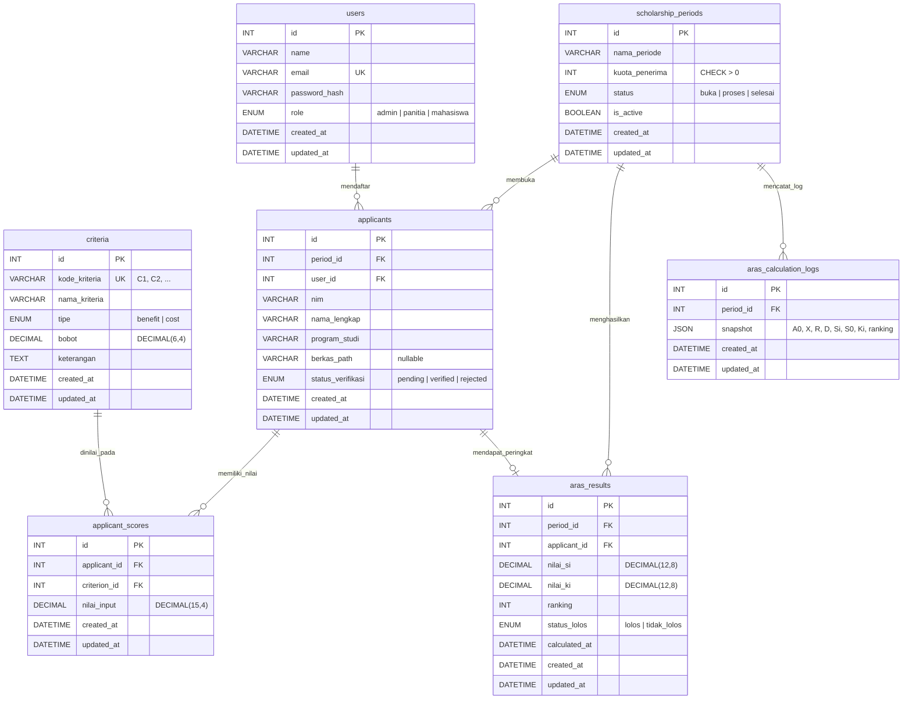

# Entity Relationship Diagram (ERD) — BeasiswaSmart (BeSmart)

Diagram relasi antar 7 tabel utama pada database MySQL 8.0+ BeSmart:

## Catatan Constraint & Integritas Data

1. **Unique Constraints**:
   - `users(email)`
   - `criteria(kode_kriteria)`
   - `applicants(period_id, user_id)` — satu mahasiswa hanya dapat mendaftar 1 kali per periode.
   - `applicant_scores(applicant_id, criterion_id)` — satu pendaftar memiliki tepat 1 nilai per kriteria.
   - `aras_results(period_id, applicant_id)` — satu hasil peringkat akhir per pendaftar dalam satu periode.
2. **Foreign Keys (`ON DELETE CASCADE`)**: seluruh relasi anak mengikuti penghapusan parent secara konsisten agar tidak terjadi data yatim (*orphan records*).
3. **Check Constraints**: `kuota_penerima > 0` pada `scholarship_periods` dan `bobot >= 0 AND bobot <= 1` pada `criteria`.

